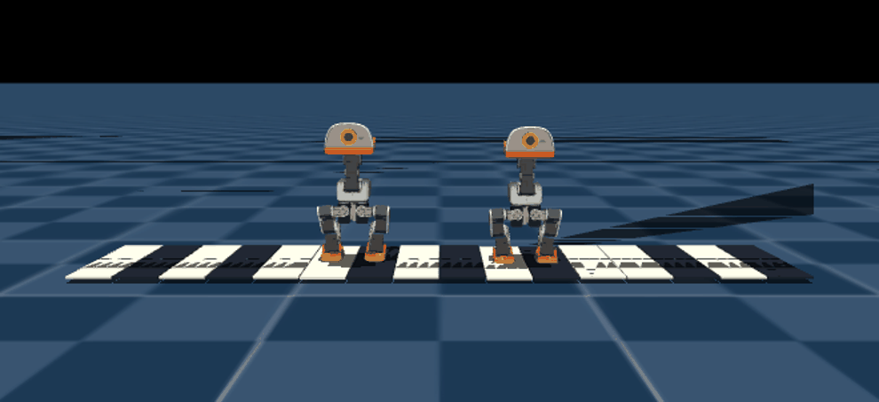

# MicroDuck Piano Learning

An honest research snapshot of two free-root MicroDuck bipeds traversing a
passive floor keyboard in MuJoCo/MJLab.



## Current result

This repository records one accepted **keyboard-traversal** rollout. It is not
yet a score-conditioned piano performance.

| Measurement | Accepted rollout |
| --- | ---: |
| Parallel evaluation worlds | 64 |
| Worlds passing every strict gate | 1 |
| Duck 0 lateral travel | 31.9 cm |
| Duck 1 lateral travel | 16.8 cm |
| Physical note-on events after settling | 24 |
| Keys completing press and release | 6 |
| Foot-on-two-keys errors | 0 |
| Falls | 0 |
| Maximum body tilt | 8.8° / 9.6° |

The full machine-readable audit is in
[`artifacts/keyboard_traversal_report.json`](artifacts/keyboard_traversal_report.json).

The ducks are not suspended or animated through state writes. After reset, the
rollout uses no root, joint, foot, contact, or key-position writes; no welds,
mocap bodies, harnesses, external forces, or scripted joint trajectories. Each
key is an unactuated 6 mm slide with a physical spring and damper. A note starts
only after 5.8 mm of key travel and releases below 0.5 mm.

## What the policy does—and does not do

The low-level actor is an actor-only transfer from Pollen Robotics' public
VelStand policy. It retains the official 61-observation/14-action contract and
was briefly fine-tuned with a touchdown-to-key-center penalty.

The visible direction changes are deliberately commanded by the evaluator:

1. walk right;
2. balance;
3. walk left;
4. balance;
5. return right.

Therefore this result establishes unsupported lateral locomotion and physical
key interaction. It does **not** establish that the ducks learned a melody,
select a requested key, or reproduce the human hopping reference. The strict
success rate is only 1/64, so this is a research milestone rather than a robust
controller.

## Method

```text
official VelStand actor
        │
        ├── actor-only warm start; critic and optimiser start fresh
        │
        └── touchdown-to-key-centre penalty
                    │
                    ▼
       16 passive spring-loaded keys
                    │
                    ▼
 displacement + alternating support + airtime + new-key landing
 + physical press/release + no seam chord + no fall
```

The 2,048-environment training run was stopped at iteration 117 when falls and
velocity-tracking degradation appeared. Checkpoint 50 was retained. Checkpoint
100 was rejected because it produced 4/16 falls, compared with 1/16 for
checkpoint 50 under the same short evaluation protocol.

## Repository contents

- `scripts/render_velstand_keyboard_traverse.py` — physical evaluator and GIF renderer.
- `assets/piano_keys.xml` — passive two-key template replicated into 16 keys.
- `artifacts/keyboard_step_model50.onnx` — retained transferred actor.
- `artifacts/velstand.onnx` — pinned official parent used for provenance checking.
- `artifacts/keyboard_traversal_report.json` — raw acceptance metrics and note events.
- `artifacts/keyboard_traversal_close.gif` — shareable visual result.

## Reproduce the evaluator

The evaluator builds directly on the upstream MJLab MicroDuck stack pinned at
commit `cb70b792312d559a4da09064d92009079671815f`.

```bash
git clone https://github.com/pollen-robotics/microduck_rl vendor/microduck_rl
git -C vendor/microduck_rl checkout cb70b792312d559a4da09064d92009079671815f
cd vendor/microduck_rl
uv sync
cd ../..

MUJOCO_GL=egl \
PYTHONPATH="$PWD/scripts:$PWD/vendor/microduck_rl/src" \
vendor/microduck_rl/.venv/bin/python \
  scripts/render_velstand_keyboard_traverse.py \
  --policy artifacts/keyboard_step_model50.onnx \
  --output runs/reproduction.json \
  --gif runs/reproduction.gif \
  --num-envs 64 \
  --seed 2140 \
  --seconds 12 \
  --key-on-mm 5.8 \
  --key-off-mm 0.5
```

The renderer requires a working MuJoCo EGL/OpenGL setup. GPU contact simulation
is not guaranteed bit-for-bit deterministic across driver and Warp versions;
the included JSON is the audit paired with the included GIF.

## Next research step

Do not continue tuning the back-and-forth velocity schedule. The missing
component is a score-conditioned high-level footstep controller that selects a
target key, support foot, and touchdown time while keeping the low-level balance
actor frozen. Human-like ballistic hopping is a separate capability and should
be treated as a longer project, not assumed from this traversal result.

## Provenance and license

- Upstream simulator: <https://github.com/pollen-robotics/microduck_rl>
- Published policies: <https://huggingface.co/pollen-robotics/microduck-policies>
- Official VelStand SHA-256: `1c659be55da94bc5753b707de5c6a3e7c49931e05ca3b6991615cef1a8ba9a45`
- Transferred checkpoint SHA-256: `f72377265adcba8032368a2ef77f5e5da9cde6785f92ec6c0917fd8f9b1a10a0`

The project retains the upstream Apache-2.0 license. No hardware-transfer claim
is made.
